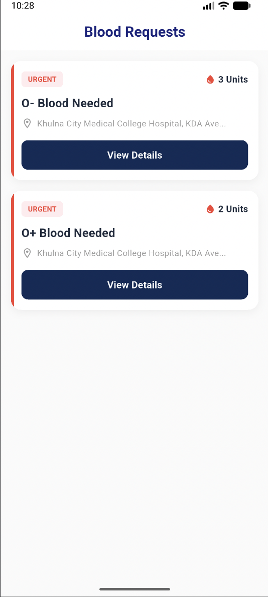

# Blood Requests UI
---
A simple, clean, and modern **Blood Request List UI** built with Flutter. The entire layout is structured inside a single file using straightforward Flutter widgets, keeping the codebase completely beginner-friendly and easy to read.

## Project Preview
---
Here is the visual snapshot of the UI output:



## Code Features
---
* **Single-File Structure:** Built sequentially within the main script without any custom widget separations or external layout components.
* **Modern Material 3 Compliance:** Implements Flutter's latest `.withValues(alpha: 0.05)` color configuration for soft drop-shadow rendering, successfully eliminating any deprecated `.withOpacity()` line-through warning errors.

## Installation & Setup
---
Follow these precise steps to clone the repository, install dependencies, and run the project locally:

### 1. Clone the Repository
---
First, open your terminal, navigate to the folder where you want to save the project, and run the following command to clone it from GitHub:
```bash
git clone https://github.com/mazbaul20/Flutter-live-test-b19-m8
```
### 2. Navigate to Project Directory
---
Switch into the project folder you just cloned:
```bash
cd Flutter-live-test-b19-m8
```
### 3. Install Dependencies
Fetch all the required Flutter packages and build files by running:
```bash
flutter pub get
```
### 4. Run the Project
Ensure you have a mobile emulator running or a real device connected, then boot up the application by executing:
```bash
flutter run
```

---
*Note: The preview screenshot is saved under the `assets/blood-requests.png` directory and is already registered inside the `pubspec.yaml` configuration.*
